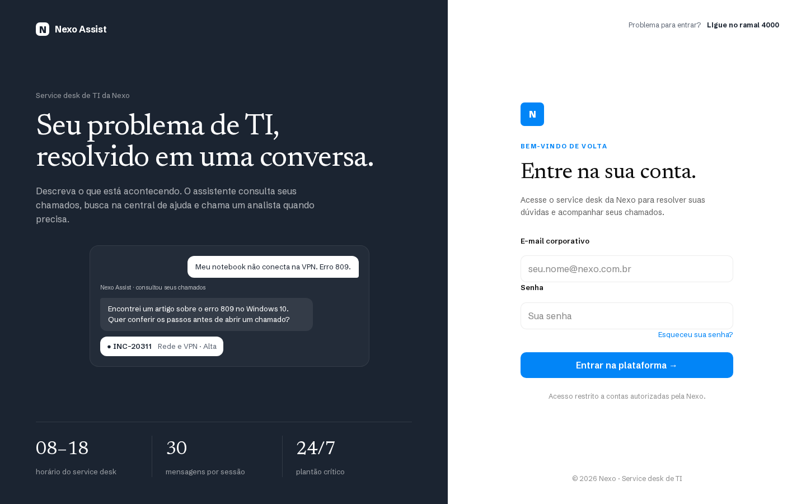
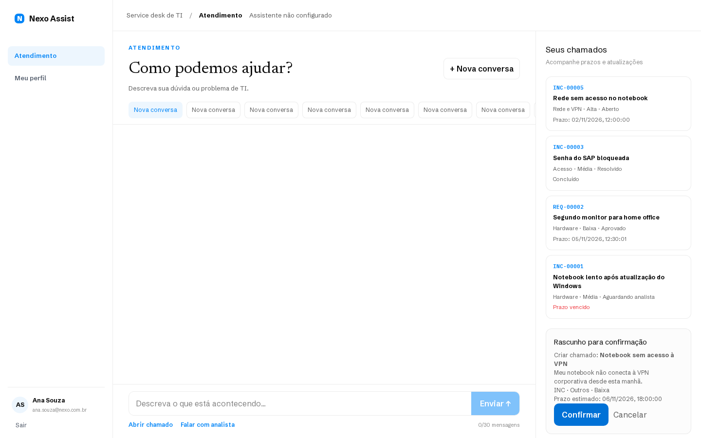
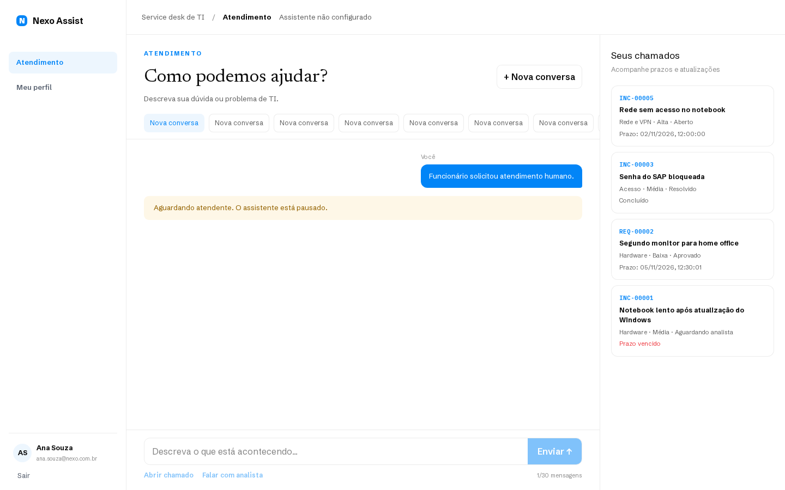
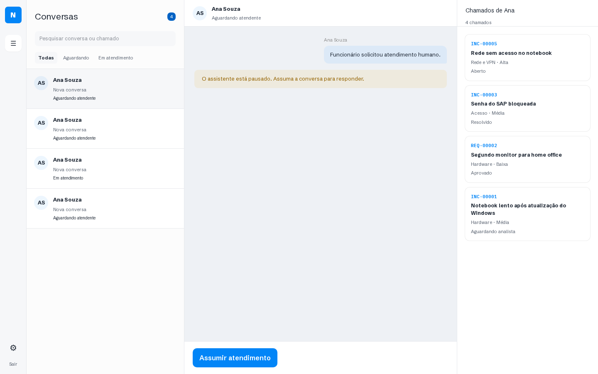
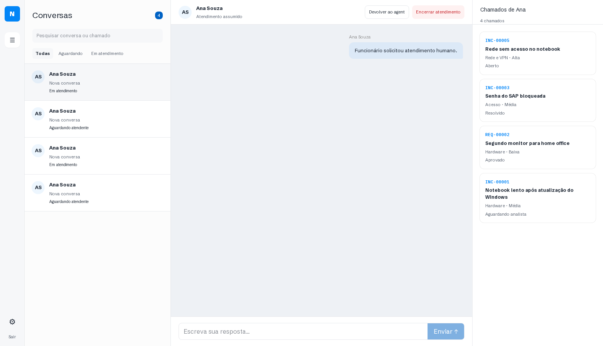
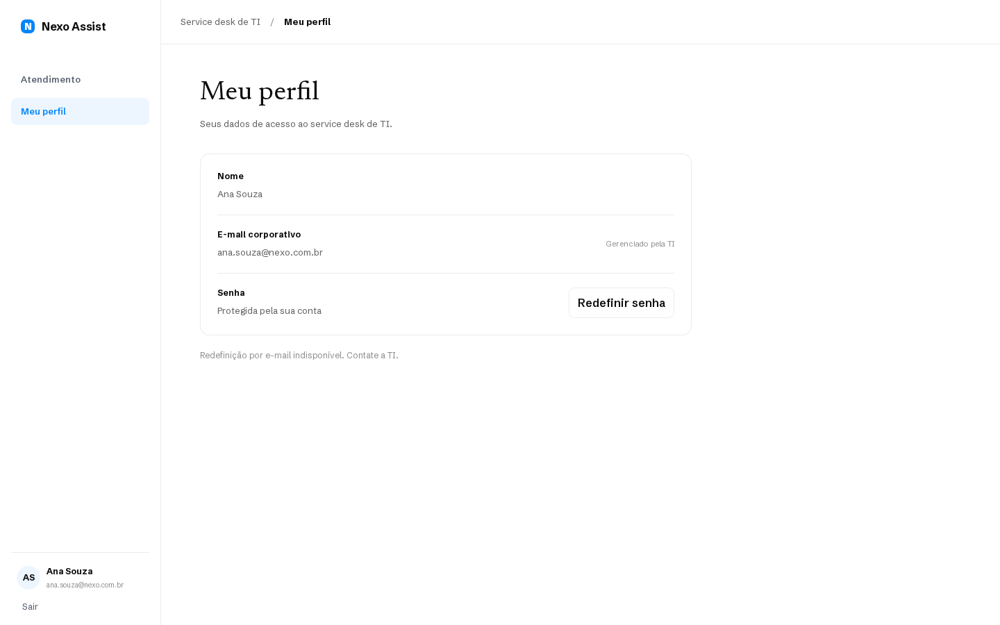
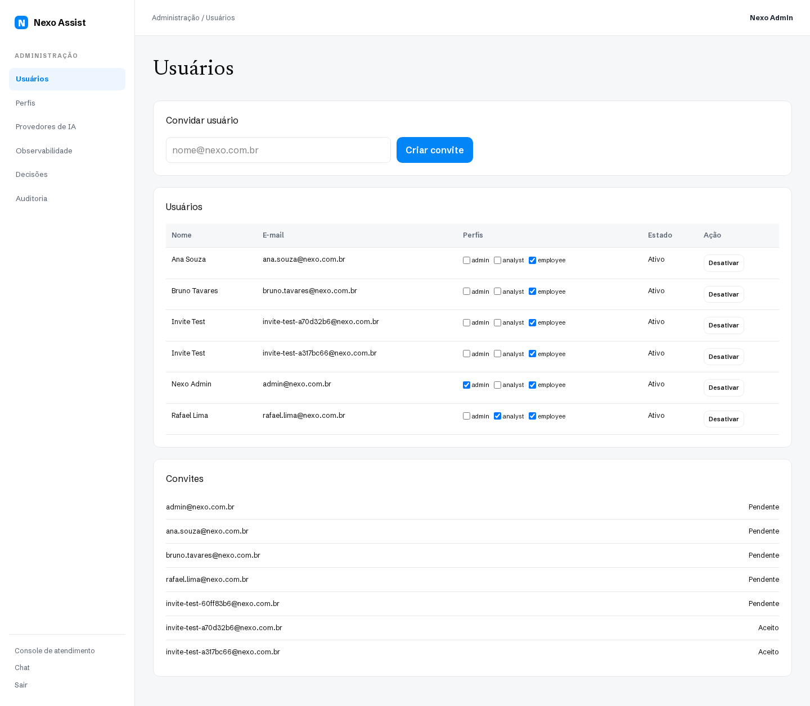

# Nexo Assist

AI-powered IT service desk for employees, analysts, and administrators. Employees consult their own tickets and a verified help center, prepare ticket drafts, and request a human analyst. Ticket changes require explicit confirmation. Analysts manage a persistent handoff queue; administrators manage invitations, permissions, AI providers, and observability.

The interface is in Brazilian Portuguese; code and documentation are in English.

## Screenshots

| Sign in                                | Ticket draft                                            | Human handoff                                 |
| -------------------------------------- | ------------------------------------------------------- | --------------------------------------------- |
|  |  |  |

| Analyst queue                                | Claimed conversation                             | Profile                                  | Administration                             |
| -------------------------------------------- | ------------------------------------------------ | ---------------------------------------- | ------------------------------------------ |
|  |  |  |  |

These are real browser captures of the local PostgreSQL-backed app. Administration has a separate visual layout from the employee and analyst workspaces.

## Features

- Invite-only Better Auth accounts with password sessions; optional Google/GitHub OAuth, explicit account linking, and Resend email.
- Persistent employee conversations with Mastra streaming, a server-enforced 30-visible-message cap, and concurrency-safe human handoff.
- Own-ticket access, full-text help search, deterministic SLA, duplicate and recent-resolution handling, and idempotent confirmation-only writes.
- Analyst claim, reply, return, and close actions with filtered queue and ticket context.
- Database-backed roles and permissions, encrypted provider credentials, and separate usage, decision, and audit records.
- DeepSeek environment bootstrap and administrator-tested DeepSeek, OpenAI, Anthropic, or OpenRouter API credentials.

## Stack and architecture

Next.js 16 App Router, React 19, strict TypeScript, Tailwind CSS 4, TanStack Query, React Hook Form, Zod, Better Auth, PostgreSQL 17, Drizzle ORM, Mastra, AI SDK providers, and pnpm. The domain-first modular monolith keeps business services in `src/modules/`, agent tools in `src/mastra/`, protected REST routes in `src/app/api/v1/`, and persistence in `src/db/`. Server code calls services directly. See [architecture](docs/architecture.md), [business rules](docs/business-rules.md), [API contracts](docs/api.md), and [decisions](docs/decisions.md).

## Local setup

Requirements: Node.js 24, pnpm 11, Docker Compose, and PostgreSQL. Copy `.env.example` to `.env.local`. Set random `BETTER_AUTH_SECRET` and `PROVIDER_ENCRYPTION_KEY` (64 hexadecimal characters), plus `BOOTSTRAP_ADMIN_EMAIL`, `BOOTSTRAP_ADMIN_PASSWORD`, `DEMO_EMPLOYEE_PASSWORD`, and `DEMO_ANALYST_PASSWORD`. Keep `.env.local` private.

```bash
pnpm install
docker compose up -d postgres
pnpm db:migrate
pnpm db:seed
pnpm dev
```

Open `http://localhost:3000`. The seed creates an administrator, employee and analyst accounts, eight help articles, and sample tickets. Demo addresses are in `src/db/seed.ts`. Set `DEEPSEEK_API_KEY` for live AI or activate a tested provider in administration. Other flows remain usable without AI; the interface marks it unavailable.

Optional: set both Google or GitHub client ID and secret and configure Better Auth callbacks for the public origin. Set `RESEND_API_KEY` and a verified `EMAIL_FROM` for invitation and password recovery mail. Invitations can also be accepted through the protected link without mail. Change all demo passwords before a public instance.

## Configuration

| Variable                                         | Purpose                           |
| ------------------------------------------------ | --------------------------------- |
| `DATABASE_URL`                                   | Persistent PostgreSQL connection  |
| `BETTER_AUTH_URL`, `BETTER_AUTH_SECRET`          | Auth origin and secret            |
| `NEXT_PUBLIC_APP_URL`                            | Public application origin         |
| `PROVIDER_ENCRYPTION_KEY`                        | Server-side AES-256-GCM key       |
| `DEEPSEEK_API_KEY`                               | Optional initial provider key     |
| `GOOGLE_*`, `GITHUB_*`                           | Optional OAuth clients            |
| `RESEND_API_KEY`, `EMAIL_FROM`                   | Optional outbound email           |
| `AI_DAILY_REQUEST_LIMIT`, `AI_DAILY_TOKEN_LIMIT` | Demo usage budgets                |
| `LEGACY_SIMULATE_OUTAGE`                         | Ticket-service failure simulation |

All settings appear in `.env.example` without private values. Provider keys entered by administrators are encrypted in the database and masked on read. Preserve the encryption key across deployments.

## Verification

```bash
pnpm lint
pnpm typecheck
pnpm test
pnpm build
pnpm start
pnpm screenshots
```

Screenshots require a seeded database, local demo credentials, a running app on port 3000, and Playwright Chromium (`pnpm exec playwright install chromium`). Tests target high-risk invariants. Live AI, OAuth, and email require real external credentials and cannot be inferred from a passing local build.

## Deployment and demonstration

Follow [deployment](docs/deployment.md) for external PostgreSQL, environment, migrations, and smoke tests. A hosted URL is supplied only after a real deployment. For a local demonstration, run the setup commands and sign in with the seeded credentials you chose.

## License

MIT. See [LICENSE](LICENSE).
